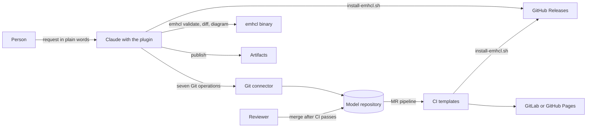

# Design of the emhcl plugin

This document describes both Claude plugins in repository release v0.1.0. It uses Axiomatic Design to show which part controls each outcome. It records the implemented design and its release constraints.

## Terms

This document uses these terms:

- Model: the `.em.hcl` files in one folder of a Git repository. emhcl reads only the files directly in the folder.
- Model repository: the Git repository of a team that holds the model and `.emhcl.yml`.
- Connector: an MCP server that gives Claude tools for one Git host.
- MR: a merge request in GitLab, or a pull request in GitHub.
- Default branch: the branch that holds the accepted model, usually `main`.
- Snapshot: a copy of the model files at one commit, in a local work folder.
- Slice: one workflow in the model, for example a `state_change` block.
- Profile: how strictly `emhcl validate` treats modeling judgment. The values are `workshop`, `valid`, and `strict`.
- Core error: an error that `emhcl validate` reports in every profile.
- Artifact: a web page that Claude publishes when the surface supports publishing.
- Procedure: the instructions in the skill for one command.

The design terms come from Kim, Suh, and Kim, "Design of Software Systems Based on Axiomatic Design" (1991):

- Functional requirement (FR): one outcome that the design must give, with an acceptance test.
- Design parameter (DP): the mechanism that gives one FR.
- Design matrix: a table with FRs as rows and DPs as columns. `X` means that a change to the DP changes the FR. `0` means no material change.
- Uncoupled: only the diagonal of the matrix has `X`.
- Decoupled: the matrix is triangular, so you set the DPs in a fixed order.
- Junction: the rule that combines child parts. S(...) combines results with no order. C(...) runs parts in a fixed order.

## System boundary

The plugins contain text and shell scripts. They have no server and no connector of their own. Collaboration needs these external parts:

- A connected GitLab or GitHub connector.
- Shell execution and permission to download and run the `emhcl` binary from GitHub Releases.
- Network access to GitHub and the Git host.
- Artifact publishing, or the generated HTML file when the surface cannot publish.
- The CI system of the model repository, which runs the plugin CI templates.
- The Git host, where a person reviews and merges each MR.

Only a person merges. No path in the diagram goes from Claude to the default branch.

## Needs and constraints

The needs describe what a person on the team wants. The constraints limit each acceptable design.

| ID | Need |
| --- | --- |
| N1 | A person sees the model of any branch as a diagram in Claude and asks questions about it. |
| N2 | A person asks for a model change in plain words and gets an MR, with no HCL or Git knowledge. |
| N3 | A reviewer sees whether the model of an MR is valid, which slices changed, and a diagram of the result. |
| N4 | Only models that pass the merge rules of the team reach the default branch. |
| N5 | The team has one canonical diagram of the default branch and one place in Claude to discuss it. |
| N6 | Another team installs and uses the plugin with no help from the author. |

| ID | Constraint |
| --- | --- |
| C1 | Apache-2.0 license and a public repository. |
| C2 | No new Git connector and no hosted service. |
| C3 | No fork of emhcl. Language changes go upstream. |
| C4 | No company-specific content in the plugin. Team rules live in `.emhcl.yml`. |
| C5 | Changes reach the default branch only through an MR. |
| C6 | GitLab Pages is the canonical diagram of the default branch. |
| C7 | A shared Claude artifact mirrors the default branch where publishing is available. Other surfaces return the generated HTML file. |
| C8 | Claude chat, Cowork, and Claude Code need separate manual tests. Collaboration requires shell execution, download permissions, network access, and a Git connector. |

## Requirements and design parameters

The top-level requirement, FR0, is this: a team views, changes, and reviews one event model through Claude. Each change reaches the default branch only through a reviewed MR. The top-level design parameter, DP0, is the plugin plus `.emhcl.yml` in each model repository. DP0 has five parts.

| ID | Functional requirement | Acceptance test | Design parameter | Files | Needs |
| --- | --- | --- | --- | --- | --- |
| FR1 | Claude and CI run the same emhcl release for each commit. | In Claude and in CI, `emhcl version` names the `emhcl_version` value of `.emhcl.yml`. | DP1, validator pin | `scripts/install-emhcl.sh`, key `emhcl_version` | N4 |
| FR2 | Claude writes and explains `.em.hcl` text in the language version that the plugin supports. | Each model that Claude writes in the eval suite has no core errors. | DP2, language skill | `plugins/emhcl-skills/skills/event-modeling-hcl/`, `references/compatibility.md`, `scripts/check-compatibility.sh` | N1, N2 |
| FR3 | Claude reads an exact snapshot at a commit. Claude writes only a new branch, an MR, or one MR comment. | Each snapshot file has the size that the connector reports. No procedure writes to the default branch or merges. | DP3, Git port | `references/git-operations.md`, shared step S3 | N1, N2, N3 |
| FR4 | People see a snapshot diagram labeled with its branch and commit. | The artifact or HTML fallback holds the unchanged `emhcl diagram` HTML, with the branch and short SHA in its title. | DP4, diagram publisher | `references/diagrams.md` | N1, N3, N5 |
| FR5 | CI blocks each MR whose model fails `merge_profile`. Pages shows the default branch after each merge. | An MR with `EM404` under `strict` cannot merge. After a merge, the Pages title names the new commit. | DP5, CI templates and fast-forward merges | `ci-templates/emhcl.gitlab-ci.yml`, `.github/workflows/emhcl-model.yml` | N4, N5 |

The skill files are under `plugins/emhcl/skills/em-collaborate/` unless the path names another folder. N6 has no FR of its own. C4 keeps the plugin generic, and em-setup composes the five DPs for a new team.

## Design matrix

| | DP1 | DP2 | DP3 | DP4 | DP5 |
| --- | --- | --- | --- | --- | --- |
| FR1 | X | 0 | 0 | 0 | 0 |
| FR2 | 0* | X | 0 | 0 | 0 |
| FR3 | 0 | 0 | X | 0 | 0 |
| FR4 | 0 | 0 | 0 | X | 0 |
| FR5 | 0 | 0 | 0 | 0 | X |

The matrix is uncoupled inside the range that `check-compatibility.sh` enforces. Each zero below has a mechanism or a test that keeps it true:

- FR1 and DP5: no CI template names an emhcl version. Both templates download `install-emhcl.sh` at the plugin tag and run it. The test `tests/structure.sh` fails when a template names a version.
- FR1 and DP2: `check-compatibility.sh` asks the binary for its version. It never reads `.emhcl.yml`, so a skill update cannot change the pin.
- FR2 and DP1, marked `0*`: a pin can name a release outside the range of the skill `event-modeling-hcl`. The cell is `0` only inside that range.
- FR3 and DP1: the Git port copies files. The emhcl release does not change which files it copies.
- FR4 and DP1: the publisher accepts each HTML file that `emhcl diagram` writes, up to 16 MiB. A new release changes the page, not the publish rule.
- FR4 and DP3: the publisher receives a folder and a title. It never calls a Git tool.
- FR5 and DP1: FR5 states a rule, "block when the pinned release fails the model". A new pin changes the verdict for one model, but the rule stays true.
- FR5 and DP3: CI reads a checkout of the repository. It does not use the connector.

The `0*` cell has three states, and `check-compatibility.sh` names each one with its exit status:

| Installed emhcl | Exit status | Effect | Cell |
| --- | --- | --- | --- |
| Older than `emhcl_min` | 1 | The procedure stops. | `X`. The design is decoupled: set the pin first, then update the plugin. |
| From `emhcl_min` to `emhcl_max_tested` | 0 | The procedure continues. | `0` |
| Newer than `emhcl_max_tested` | 3 | The procedure continues and repeats the warning in the report. | `?`. No test covers that release. |

The five DPs share three things. The design controls the first two. The third is a residual risk:

- The file `.emhcl.yml`. Each key has exactly one owner DP, and the comment of each key names the owner. Other parts only read the key. The section "Configuration" lists the owners.
- The order of merges. Two MRs can pass alone and break the model together, for example with the same slice ID in two files. With fast-forward merges, the second MR must rebase, and CI then validates the result that will land.
- The network path to github.com. Claude and CI both download emhcl and the install script from GitHub. If GitHub is not available, FR1 and FR5 fail at the same time.

## Module contracts

This section gives the contract of each DP. A contract names the inputs, the outputs, the state that the part owns, and the behavior on failure.

### DP1: validator pin

`install-emhcl.sh` is the only reader of `emhcl_version`. Claude and CI both run it.

| Item | Contract |
| --- | --- |
| Input | `--config <path to .emhcl.yml>`, optional `--bin-dir <folder>`. Environment variables `EMHCL_BIN_DIR`, `EMHCL_RELEASE_URL`, and `EMHCL_NO_GO`. |
| Output | The absolute path of the binary, as the last line on stdout. Messages go to stderr. |
| Owned state | The key `emhcl_version`, and the binary in the install folder. |
| Method | Download `emhcl_<version>_<os>_<arch>.tar.gz` (`.zip` on Windows) and `checksums.txt`. Install only when the SHA-256 sums match. If the download fails, run `go install` at the same tag. |
| Invariant | A wrong sum stops the script with exit 1. The script never falls back to `go install` after a wrong sum, and it keeps the old binary. |
| Exit status | 0 installed, 1 failure, 2 usage error. |

If the folder already holds a binary that reports the pinned tag, the script installs nothing and prints the path.

### DP2: language skill

The skill `event-modeling-hcl` lives in the plugin `event-modeling-skills` in this repository. The plugin `event-modeling-hcl-plugin` declares it as a dependency. Only Claude Code installs that dependency automatically. In Claude chat and Cowork, install both plugins separately. Repository release v0.1.0 uses language skill 3.1.0 for specification v0.8.0 and emhcl v0.17.0 or newer. The language skill came from emhcl v0.17.0.

| Item | Contract |
| --- | --- |
| Input | The front matter of the skill (`version`, `spec_version`, `emhcl_min`), and an upstream tag for the example, through `scripts/sync-upstream.sh`. |
| Output | The example model `examples/pet-clinic/model` and `compatibility.md`. |
| Owned state | The language rules, the authoring rules, and the repair loop, in `event-modeling-skills`. `compatibility.md` records `upstream_tag`, `skill_version`, `spec_version`, `emhcl_min`, and `emhcl_max_tested`. |
| Invariant | Nobody edits `compatibility.md` or the example by hand. `sync-upstream.sh --check <tag>` exits 1 when a file differs from the tag and the skill. With `EMHCL` set, it also exits 1 when `spec_version` differs from the binary. |
| Range guard | `check-compatibility.sh <binary>` compares the version of the binary with `emhcl_min` and `emhcl_max_tested`. |

The repair loop belongs to the skill `event-modeling-hcl`. It has one circuit breaker for each diagnostic code on one element, with a limit of two failed repairs. The plugin uses that limit and defines no retry count of its own.

An eval of the path `plugins/emhcl` loads only that plugin, so the language evals live in `event-modeling-skills`. The method skills and their authorities are described in [Skill boundaries and authorities](#skill-boundaries-and-authorities).

### DP3: Git port

`git-operations.md` names seven operations. Procedures use only these names, and the file binds each name to connector tools.

| Operation | What it does | GitLab MCP server | GitHub MCP server |
| --- | --- | --- | --- |
| resolve-ref | Gets the commit SHA of a branch, and the name of the default branch | `get_project`, `get_commit` | `get_commit`, `search_repositories` |
| list-model | Lists the files of `model_path` at a commit | `list_repository_tree` | `get_repository_tree` |
| read-file | Reads one file at a commit | `get_repository_file` | `get_file_contents` |
| commit-branch | Makes a new branch with all changed files | `add_commit` with `start_sha` | `create_branch`, `push_files`, `delete_file` |
| open-mr | Opens an MR, as a Draft when the procedure asks | `save_merge_request` | `create_pull_request` |
| read-mr | Gets the base commit, the head commit, and the changed files of an MR | `get_merge_request` | `pull_request_read` |
| comment-mr | Adds one comment to an MR | `save_note` | `add_issue_comment` |

The port has these invariants:

- No procedure calls `accept_merge_request`, `merge_pull_request`, `save_merge_request_review`, `create_or_update_file`, or a tool that writes to the default branch.
- commit-branch writes only to a branch that the same procedure made in the same run. The branch name is `branch_prefix`, a short name of the change, and the first 8 characters of the snapshot commit.
- On GitLab, commit-branch sends the full content of each file in one `add_commit` call. It never sends a partial edit, so the branch holds exactly the validated files.
- No line of an MR description or comment starts with `/`, because GitLab reads such a line as a quick action.
- If a tool is missing, the procedure stops and names the tool.

The snapshot rule, shared step S3, also belongs to DP3. It writes each file to `<work>/<sha>/` exactly as the tool returns it. Then it compares the size of each written file with the size that the connector reports. If a size differs twice, the procedure stops. A snapshot folder is never edited, so em-change edits a copy.

### DP4: diagram publisher

`diagrams.md` turns a snapshot folder into an artifact.

| Item | Contract |
| --- | --- |
| Input | A snapshot folder, a title, and an optional artifact URL. |
| Output | An artifact URL, or `Artifact: none` with the reason. |
| Owned state | The key `team_artifact_url`. |
| Method | Run `emhcl diagram --title <title> -o <file>`. Publish the HTML file unchanged. With a URL, publish a new version of that artifact. Without a URL, publish a new artifact. |
| Limits | A file over 16 MiB is not published. The publisher never calls Git tools and never changes model files. |
| Failure | If the surface cannot publish a file, the publisher gives the HTML file to the person. It never makes a page by hand. |

The titles carry the commit, so a difference from Pages is visible:

| Procedure | Title |
| --- | --- |
| em-view, em-sync | `<project> <branch> @ <short SHA>` |
| em-review | `<project> <source branch> @ <short head SHA>` |
| em-change | `<project> <new branch> @ <short base SHA> (proposal)` |

Claude cannot change who has access to an artifact. So after each new artifact, the procedure tells the person how to share it.

### DP5: CI templates

The GitLab template and the reusable GitHub workflow give a model repository two jobs.

| Job | Runs on | Does |
| --- | --- | --- |
| `emhcl-validate` | Each MR pipeline and each push to the default branch | Validates `model_path` with `merge_profile`. A failure fails the job. |
| `pages` | Each push to the default branch | Renders `model_path` with the title `<project> <branch> @ <short SHA>`, and publishes it to Pages. |

The two jobs are a summation junction: each job runs without the other. So Pages shows the default branch even when `emhcl-validate` fails there. The templates take one input, `plugin_ref`, which is the plugin tag. The tag selects the version of `install-emhcl.sh`, and the script selects the emhcl release from `.emhcl.yml`.

The merge gate needs two project settings that em-setup cannot make. A maintainer sets them:

- GitLab: the merge method "Fast-forward merge", and "Pipelines must succeed".
- GitHub: "Require linear history", and a required status check for `emhcl-validate`.

## Configuration

Each model repository has one `.emhcl.yml` at its root. The keys are flat `key: value` lines, so a shell script reads a key with one `sed` command. Each key has one owner.

| Key | Owner | Value when absent | Readers |
| --- | --- | --- | --- |
| `emhcl_version` | DP1 | None. The installer stops. | `install-emhcl.sh` only |
| `model_path` | DP3 | `model` | Procedures, CI jobs |
| `branch_prefix` | DP3 | `model/` | em-change, em-setup |
| `mr_labels` | DP3 | `[]` | open-mr on GitLab |
| `reviewers_hint` | DP3 | `""` | em-change |
| `merge_profile` | DP5 | `strict` | CI, em-change, em-review, em-sync |
| `draft_profile` | Commands | `workshop` | em-view, em-validate |
| `canonical_url` | DP5 | `""` | em-view, em-sync |
| `team_artifact_url` | DP4 | `""` | em-sync |

No procedure changes a key as a side effect. If the file is missing, em-setup proposes it through an MR. em-view and em-validate still run with a temporary file in the snapshot folder, which pins `emhcl_max_tested`. em-change, em-review, and em-sync stop, because a proposal or a review needs the pin that CI uses.

## Composition of the commands

A command adds no mechanism of its own. Each file in `commands/` names a procedure of the skill `em-collaborate`. Claude chat loads commands as skills. The procedures define intended behavior across apps, subject to tool availability and separate manual tests.

The skill defines six shared steps. The procedures run them in this order:

| Step | Does | Part |
| --- | --- | --- |
| S1 | Finds the repository and the connector. Stops when no connector is available. | DP3 |
| S2 | Makes the work folder `${TMPDIR:-/tmp}/emhcl/<project>`. | Skill |
| S3 | Takes a snapshot at a commit. | DP3 |
| S4 | Installs the pinned emhcl, then runs the range guard. | DP1, DP2 |
| S5 | Runs `emhcl validate --profile <profile> --format json`. | DP1 |
| S6 | Publishes a diagram. | DP4 |

Each command composes the DPs with a junction:

| Command | Composition | Writes to Git |
| --- | --- | --- |
| em-setup | S(DP3 tools present, DP1 install, DP2 range, `.emhcl.yml` read), then C(DP3 commit-branch → DP3 open-mr) only for a missing file | Only an MR that adds `.emhcl.yml` |
| em-view | C(DP3 snapshot → DP1 validate with `draft_profile` → DP4 publish) | No |
| em-validate | C(DP3 snapshot → DP1 validate with the named profile, else `draft_profile` → explain) | No |
| em-change | C(DP3 snapshot → DP2 edit and repair → DP4 proposal artifact → DP3 commit-branch → DP3 open-mr) | A new branch and an MR |
| em-review | C(DP3 read-mr and snapshots → DP1 validate the head with `merge_profile` → slice comparison → DP4 publish → DP3 comment-mr) | One comment |
| em-sync | C(DP3 snapshot of the default branch → DP4 republish to `team_artifact_url`) | No |

A request to merge an MR matches no procedure. Claude says that the plugin never merges, and that a reviewer merges the MR after CI passes.

### The order inside em-change

em-change has five child requirements. Their matrix is lower triangular, so em-change is decoupled, and its run order is fixed.

| ID | Requirement | Design parameter |
| --- | --- | --- |
| E1 | A snapshot of the default branch at commit S, and a copy to edit | S1 to S4 |
| E2 | An edited copy with no core errors that applies the request | DP2 authoring rules and repair loop, with S5 |
| E3 | A proposal artifact of the edited copy | DP4, as a new artifact |
| E4 | A new branch from S with all changed files | commit-branch of DP3 |
| E5 | An MR from that branch with the artifact link, as a Draft when the copy fails `merge_profile` | open-mr of DP3 |

| | DP-E1 | DP-E2 | DP-E3 | DP-E4 | DP-E5 |
| --- | --- | --- | --- | --- | --- |
| E1 | X | 0 | 0 | 0 | 0 |
| E2 | X | X | 0 | 0 | 0 |
| E3 | 0 | X | X | 0 | 0 |
| E4 | X | X | 0 | X | 0 |
| E5 | 0 | X | X | X | X |

E2 edits the files of E1. E3 shows the result of E2. E4 needs the commit of E1 and the files of E2. E5 needs the Draft status from E2, the link from E3, and the branch from E4.

E2 runs these steps on the copy:

1. Edit the files with the rules of the upstream skill. If the request leaves a business decision open, ask one question or record an open `hotspot`.
2. Run `emhcl fmt -w` only on the files that changed.
3. Validate with the profile `valid`. Repair while `has_core_errors` is true, until the breaker of the upstream skill opens.
4. Validate with `merge_profile`. If `has_errors` is true, the MR will be a Draft.
5. Run `emhcl diff` between the snapshot and the copy. If nothing changed, stop.

Each failure has one rule:

| Failure | Result |
| --- | --- |
| The repair breaker opens in E2 | Nothing goes to Git. The report names each remaining diagnostic and the two attempts. |
| E3 cannot publish | The MR description says that no diagram link exists. |
| E4 fails | em-change reports the error. The artifact stays private to the author. |
| E5 fails | em-change reports the branch name. It repeats only E5 when the person asks. |

The rule "a model with core errors never leaves Claude" follows from this order. Only E4 and E5 write to Git, and they run only after E2 ends with no core errors.

### Data flow of em-review

em-review reads the MR first and takes the base commit B and the head commit H from it. It snapshots both commits and uses the `model_path` of H for both. It installs emhcl with the `.emhcl.yml` of H, because CI uses the configuration of the MR. Then it runs `emhcl diff --format json` between B and H. Each top-level entry of kind `workflow` is an added, removed, or changed slice, and other entries are catalog changes. emhcl compares the typed models, so a block that only moved to another file gives no entry.

## Residual risks

The design accepts the risks below. Each one has a stated effect and a control.

| Risk | Effect | Control |
| --- | --- | --- |
| The GitHub connector cannot start a branch at a commit. | Between the second resolve-ref and `create_branch`, the default branch can move. Then the branch does not start at S. | em-change runs resolve-ref again before the commit, and restarts one time. CI validates the rebased result with fast-forward merges. |
| On GitHub, `delete_file` adds one commit for each deleted file. | A change that deletes files has more than one commit. | None in 0.1.0. The content of the branch is still the validated copy. |
| GitHub pull requests get no labels. | `mr_labels` has no effect on GitHub. | Documented in `configuration.md`. |
| The snapshot compares file sizes, not hashes. | A damaged file of the same size is not found. | None in 0.1.0. CI validates its own checkout, so the merge gate does not depend on the snapshot. |
| A pin newer than `emhcl_max_tested`. | The skill and the validator can disagree. The cell FR2 and DP1 becomes unknown. | The range guard warns, and the report repeats the warning. |
| GitLab older than 19.4 | `add_commit` has no `start_sha`, so em-change cannot write. | em-setup reads the tool schema and reports the problem. |
| The diagram HTML is larger than 16 MiB. | No artifact. | The publisher names `canonical_url`. |
| github.com is not available. | FR1 and FR5 fail together. | The `go install` fallback also needs the network. No control in 0.1.0. |

## Information content

Information content is I = -log2(p), where p is the probability that a design meets its FR. Among designs that pass the matrix test, the design with the lower I is better. No measured p exists yet for this plugin. So this section names the open choices and the measurement that decides each one.

| Choice | Alternatives | Measurement | Decision rule |
| --- | --- | --- | --- |
| Install method in Claude | Release archive first, or `go install` first | Run each method in 20 new Claude chat sandboxes. | The method with more successes goes first. |
| Proposal diagram for reviewers | An artifact that the author shares, or an HTML file that CI attaches to the MR | Count how many of the first 10 MRs had a reviewer who opened the diagram. | If the count is less than 9, add the HTML file to the CI templates. |

Functional independence does not mean independent failures. FR1 and FR5 both need github.com. So do not add their information content as if their failures were independent.

## How the tests keep the design true

The tests in `tests/` and the eval suite in `plugins/emhcl/evals/` test the claims of the matrix and the contracts.

| Claim | Test |
| --- | --- |
| A change of `emhcl_version` changes the installed release. | `tests/install-emhcl.test.sh`, "a change of the pin changes the installed release" |
| A wrong SHA-256 sum installs nothing and keeps the old binary. | `tests/install-emhcl.test.sh`, two cases |
| No CI template names an emhcl version (FR1 and DP5). | `tests/structure.sh` |
| Only `install-emhcl.sh` reads `emhcl_version`. | `tests/structure.sh` |
| Each key of the example `.emhcl.yml` has one owner tag. | `tests/structure.sh` |
| Each command names an existing procedure, and no other command exists. | `tests/structure.sh` |
| No procedure names a merge tool. | `tests/structure.sh` |
| The example and `compatibility.md` equal the upstream tag and the skill. | `tests/structure.sh`, through `sync-upstream.sh --check` |
| `event-modeling-hcl-plugin` depends on `event-modeling-skills`, which holds `event-modeling-hcl`. | `tests/structure.sh` |
| The manifests are valid. | `claude plugin validate --strict`, in `tests/structure.sh` |
| A written model has a board, a state change, and typed fields. | Eval `author-slice`, in `event-modeling-skills` |
| Claude explains CI diagnostics and does not invent a rule. | Eval `explain-ci-diagnostics` |
| Claude declines to merge. | Eval `never-merges` |
| Without a connector, Claude stops and names the missing connector. | Eval `view-without-connector` |

A plugin eval loads only the MCP servers that the plugin declares, and this plugin declares none. So no eval covers DP3. The manual test list in `CONTRIBUTING.md` covers the Git procedures on GitLab and GitHub for each release.

## Release design decisions

Repository release v0.1.0 uses these decisions:

- The example pins emhcl v0.17.0 and supports specification v0.8.0. `emhcl_min` is 0.17.0.
- The language skill lives in `event-modeling-skills`. `event-modeling-hcl-plugin` declares a dependency on it for Claude Code. Other apps need both plugins installed separately.
- The range guard is a separate script, `check-compatibility.sh`. It reads the binary version, not `.emhcl.yml`, so DP1 remains the only reader of the pin.
- em-change and em-review compare models with `emhcl diff`, not block text. A block that only moved to another file is not a change.
- The connector bindings define the Git tools. em-setup also calls `get_mcp_server_version`. On GitLab before 19.5, read-mr uses `get_merge_request_diffs`.
- The reusable GitHub workflow is part of v0.1.0.
- em-view and em-validate run without `.emhcl.yml`, with a temporary pin.
- Both plugins share one manually created repository tag, `v0.1.0`. Future repository releases use `v<version>`, not per-plugin tags.

## Paper-world discovery boundary

Paper-world questions belong to business discovery. They expose decisions and information handoffs without copying software controls into the business story. They do not require a separate model, writer, or gate.

The shared rules live in K1 of `contract/method.md`. The event writer uses them to discover facts. The workshop facilitator uses a reset exercise and sends the answers to the affected writer. Neither responsibility expands into writing the other model parts.

The reset preserves source evidence under K8 and actual system actors. A paper stand-in explains an automation's business job, but it does not establish human execution. A sheet informs an actor, but it does not become the authority that validates a command.

Before encoding a paper account, resolve the system boundary, actual executors, command authority, and recorded failure outcomes. Unknown decisions remain questions. The existing representation rules must preserve business meaning rather than change it to fit the format.

Use Axiomatic Design for changes to skill responsibilities, shared contracts, and downstream software boundaries. Do not require its matrices during an ordinary business workshop. File separation alone does not prove that changing one responsibility leaves every other outcome unchanged.

The focused behavior cases in `plugins/emhcl-skills/evals/` cover replacement discovery, stale displayed information, actual automation, and continuation of existing work. These cases exercise the boundaries. They do not prove whole-system independence or provide probabilities for the Information Axiom.

## Skill boundaries and authorities

This section is for maintainers who change skill responsibilities.
It covers business modeling, HCL encoding, edit permissions, and task selection.
It does not change the Git, diagram, or validator-pin boundaries described earlier.

### Needs and required outcomes

N1 is the need to model business behavior without competing rules.
N2 is the need to preserve that behavior in HCL.
N3 is the need to protect existing work and shared consumers.
N4 is the need to select the right work without repeating completed discovery.
These needs apply to business-only models, HCL files, and folder models.

A functional requirement (FR) states a required outcome.
A design parameter (DP) is the mechanism chosen to control that outcome.
The acceptance criteria below are proposed architecture criteria, not measured success rates.
All four FRs have the parent outcome FR0: complete the requested modeling task safely.

| FR | Need | Required outcome and acceptance criterion | DP and responsibility |
| --- | --- | --- | --- |
| FR1 | N3 | Leave locked workflows and affected shared consumers unchanged without named approval. Apply this to formatting, identities, and connected edits. | DP1: K13 controls permissions and approval scope. |
| FR2 | N1 | Preserve supplied rules, field sources, and observable scenarios. Keep material unknowns visible. | DP2: the method contract and part writers control business meaning. |
| FR3 | N2 | Encode agreed meaning with legal HCL. Report an unsupported intent rather than changing its meaning. | DP3: the language skill controls syntax and tools. The binding assigns HCL constructs to model parts. |
| FR4 | N4 | Select the responsible writer or review without restarting completed work. Keep business-only results free of HCL requirements. | DP4: descriptions select focused skills. The orchestrator selects incomplete parts, and the facilitator manages live sessions. |

The fixed constraints are HCL v0.8.0 compatibility and the existing model medium.
An ordinary business workshop does not need HCL, Event Sourcing, or a software architecture.
An HCL task must retain the supplied file or folder shape unless a change is requested.
All required shared references must work inside the installed plugin.

### Why the umbrella skill was retired

The former `event-modeling` skill controlled discovery and business review.
The 32 specialists also controlled those outcomes through a separate method contract.
The language skill delegated business questions to the umbrella, while specialists wrote HCL directly.
This created two business authorities and two places for some encoding rules.

The old business-and-encoding branch had the following influence matrix.
Rows are required outcomes, and columns are mechanisms whose changes can affect them.
`X` means a material influence, `0` means no material influence under the stated boundary, and `?` means unresolved influence.

| Outcome | Umbrella business rules | Specialist business rules | Language rules |
| --- | --- | --- | --- |
| Business meaning | X | X | 0 |
| Faithful HCL encoding | X | X | X |

This rectangular matrix exposes redundant business controls.
It does not establish a coupled or uncoupled square design.
The zero assumes that language work preserves meaning and reports representation gaps.
The umbrella folder also held the stronger edit policy, so deleting it without migration left FR1 without its full control.

The retained design assigns each shared rule one canonical source.
K13 of `contract/method.md` owns permissions.
Other method sections own business rules.
The language skill owns syntax and tools, and `contract/hcl-binding.md` owns the mapping from parts to HCL constructs.
The generator publishes those sources inside the installed skills.

### Independence and order

The proposed matrix uses the same FRs and DPs as the requirements table.
It describes changes to policies and responsibilities, not a call graph.
The zeros depend on every writer respecting the shared permission and meaning boundaries.
Agent behavior must still be exercised before treating those boundaries as reliable.

| Outcome | DP1 permissions | DP2 meaning | DP3 encoding | DP4 selection |
| --- | --- | --- | --- | --- |
| FR1 permitted changes | X | 0 | 0 | 0 |
| FR2 business meaning | X | X | 0 | 0 |
| FR3 faithful encoding | X | X | X | 0 |
| FR4 correct task selection | X | X | X | X |

This is a conditional decoupled design, which means that its controls require an order.
Establish permissions first, business responsibilities second, encoding rules third, and task-selection rules last.
This is design order, not a requirement to run a workshop before every syntax repair.
An encoding change must preserve business meaning, and a selection change must preserve all writer boundaries.

The off-diagonal entries have concrete causes.
Permissions determine which business and HCL changes can proceed.
Business changes require new encoding and can reopen earlier completion checks.
Language capabilities and diagnostics determine whether selection returns a syntax repair or an unresolved business question.
Changing any of these authorities requires reviewing the affected selection rules.

The zeros are bounded claims.
A syntax repair with known meaning must not restart discovery.
Changing the facilitator's pacing must not change a writer's business rules.
A shared event rename is not independent work: its consumers and permissions must be examined together.
These local boundaries do not prove whole-system independence.

### Module contracts and composition

Part writers take source evidence and existing model content as inputs.
They own only their named model part and its records.
They return that part, its uncertainty, and requests for changes in other parts.
They must stop an unauthorized connected edit without leaving partial contracts behind.

Review skills take existing content as input and return findings.
A review request grants no permission to fix the model.
Source-intake skills attach evidence and requests rather than writing business elements.
The model holds durable evidence, decisions, questions, and requests instead of a second working artifact.

The language authority takes agreed meaning and an authorized edit scope.
It supplies encoding rules, version requirements, tool gates, and diagnostic handling.
It must report an unavailable tool or unsupported intent without inventing a successful validation result.
The HCL binding selects constructs for each part but does not redefine the language or tool lifecycle.

The orchestrator takes the model, sources, and requested scope.
It selects the first incomplete part and loads its writer.
The facilitator takes participant and session information and manages a live group.
Neither coordinator writes model elements.

S, summation, combines the writers' completed parts into the requested model.
C, control, orders dependent parts and tool gates.
F, feedback, returns review requests to the responsible writer.
The feedback loop stops under K12 and the orchestrator's repeated-failure rule.
It does not justify silent edits to other parts or unbounded repair attempts.

### Alternatives and evidence limits

Keeping both business authorities retains conflicting instructions and duplicate maintenance.
Keeping only the umbrella discards the specialists' focused ownership and coordination.
Removing the umbrella after migration preserves those responsibilities without adding another dispatcher.
This is the selected design, subject to behavior evidence rather than file count.

The Information Axiom compares the probability of meeting all required outcomes.
No supported joint success probability exists for these alternatives.
Fewer skills or fewer words do not establish lower information content.
Compare the alternatives on the same business, encoding, permission, and routing cases before making a probability claim.

The migrated evaluation cases preserve business-only discovery, uncertain translation, automation dispatch, and read-only review.
The HCL cases preserve encoding, narrow repairs, and locked shared consumers.
Additional change scenarios must exercise a shared rename, a stale display, a representation gap, and a syntax-only repair.
Loader checks and generated-copy checks prove packaging properties, not correct agent decisions.

## Sources

- `plugins/emhcl/skills/em-collaborate/SKILL.md` and its `references/` and `scripts/` folders
- `plugins/emhcl-skills/skills/event-modeling-hcl/SKILL.md`, section on the repair loop
- `ci-templates/emhcl.gitlab-ci.yml` and `.github/workflows/emhcl-model.yml`
- `scripts/sync-upstream.sh`, `tests/structure.sh`, and `tests/install-emhcl.test.sh`
- `README.md`, `CONTRIBUTING.md`, and `CHANGELOG.md`
- Kim, Suh, and Kim, "Design of Software Systems Based on Axiomatic Design", Robotics and Computer-Integrated Manufacturing 8(4), 1991, pp. 243–255
